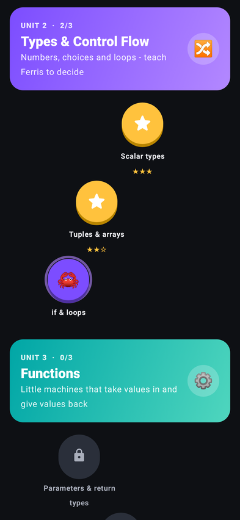
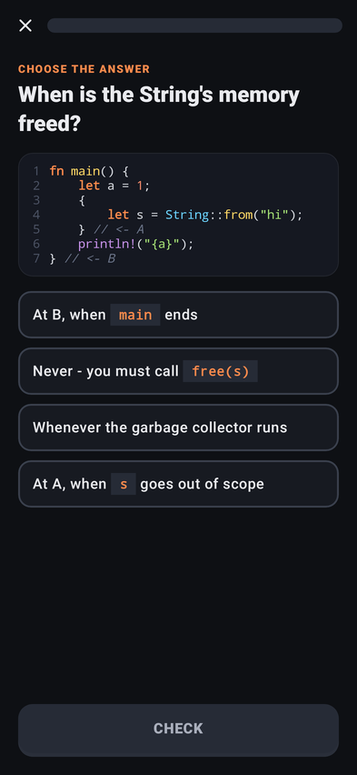
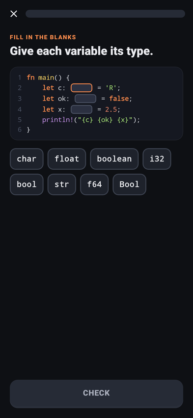
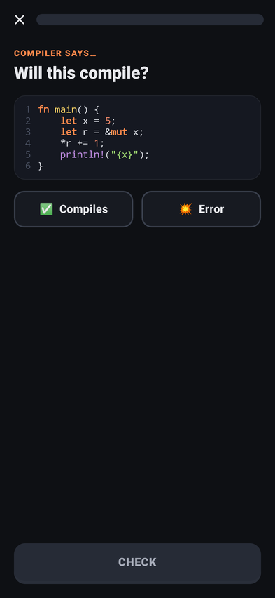
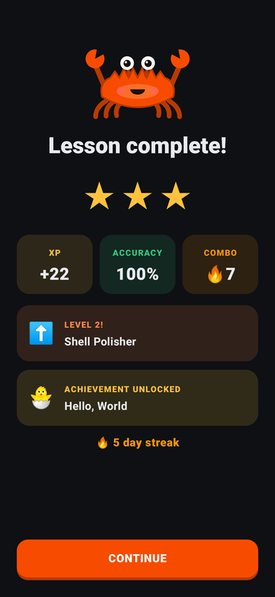
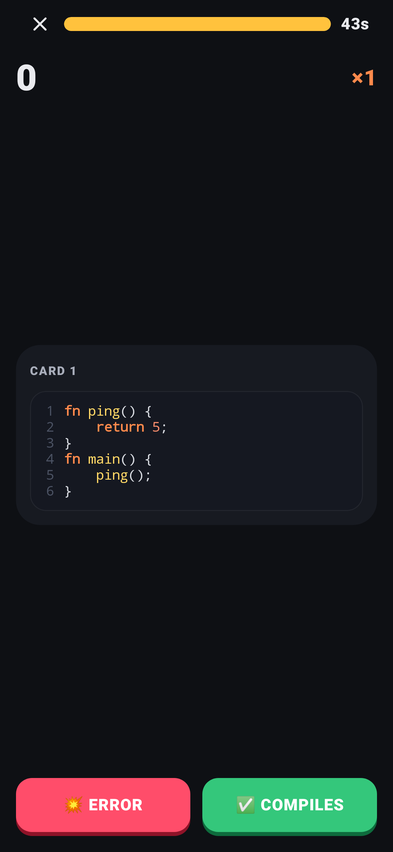
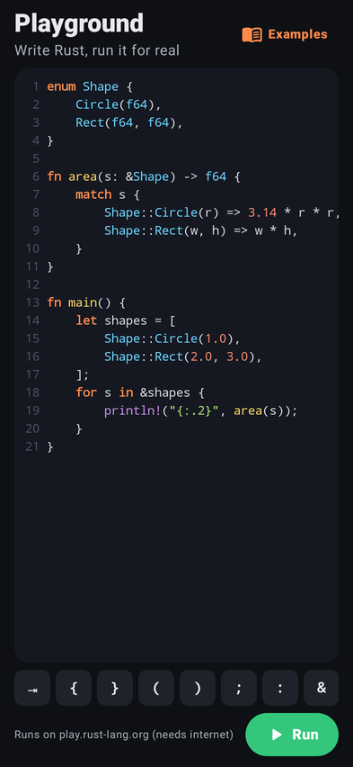
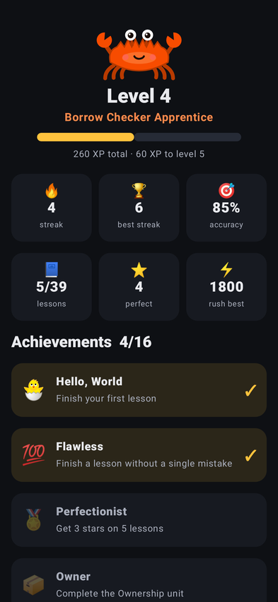

# Rustle 🦀

An Android app for learning the **Rust programming language** in short, game-like lessons, with Ferris the crab as your guide.

<p>








</p>

## Features

- **Learning path**: 13 units, 39 lessons, ~380 steps, from `println!` to ownership, borrowing, traits, lifetimes and fearless concurrency. Lessons unlock as you go (or turn on *Explorer mode*).
- **Five exercise types**: multiple choice ("what does this print?"), fill in the blanks, put the lines in order, *will it compile?*, and *tap the line the compiler complains about*. Missed exercises come back at the end of the lesson.
- **Compiler Rush ⚡**: a 45-second swipe game. Right if it compiles, left if `rustc` says no. Streaks multiply your score.
- **Playground**: write Rust on your phone (syntax highlighting, auto-indent, a row of symbol keys) and run it on the official [Rust Playground](https://play.rust-lang.org). Needs internet; everything else works offline.
- **Motivation**: XP and levels, daily goal, streaks, star ratings, 16 achievements, and a *Practice* mode that resurfaces your past mistakes.
- Light and dark theme.

## Every answer is checked by the real compiler

Lesson content lives in plain text files in [`app/src/main/assets/course/`](app/src/main/assets/course) ([format](docs/COURSE_FORMAT.md)). The `verify-course` tool compiles every snippet with `rustc` (edition 2024): "will it compile?" cards must compile (or fail) as claimed, "what does this print?" answers must match the program's real output, and "spot the bug" lines must be where rustc reports the error. That's ~270 checks.

```sh
cargo run --release --manifest-path core/Cargo.toml --bin verify-course
```

## A Kotlin app with a Rust core

The screens are Kotlin + Jetpack Compose. Everything else, the course parser, answer grading, and the rules for XP, stars, streaks, levels, achievements, practice sets and the Rush deck, is a Rust library in [`core/`](core). The app calls it through [UniFFI](https://mozilla.github.io/uniffi-rs/)-generated Kotlin bindings. The course verifier uses the same parser, so what the checker approves is exactly what the app loads.

## Building

Requires JDK 17+, the Android SDK (API 36) with NDK 30.0.16248370, and Rust with the Android targets and cargo-ndk:

```sh
rustup target add aarch64-linux-android armv7-linux-androideabi x86_64-linux-android
cargo install cargo-ndk
```

Gradle builds the Rust core automatically (for the phone and for the JVM tests) and generates the bindings.

```sh
./gradlew :app:assembleDebug            # app/build/outputs/apk/debug/app-debug.apk
./gradlew :app:assembleRelease          # minified, signed with the debug key for sideloading
./gradlew :app:testDebugUnitTest        # content, full-UI and screenshot tests (Robolectric + native core)
cd core && cargo test                   # parser, grading and progress rules
```

GitHub Actions builds both APKs and uploads them as artifacts on every push.

## Project layout

| Path | What |
|---|---|
| `core/` | **Rust**: course model and parser, grading, progress/XP/achievement rules, `verify-course` tool |
| `app/…/course/` | Loads course files and hands them to the Rust core |
| `app/…/data/` | Saves progress on the device |
| `app/…/ui/home` | The winding lesson path |
| `app/…/ui/lesson` | Lesson player, exercise views, results screen |
| `app/…/ui/rush` | Compiler Rush |
| `app/…/ui/playground` | Editor and Rust Playground client |
| `app/…/ui/components` | Ferris (drawn in code), confetti, buttons, Markdown |

Built with Kotlin, Jetpack Compose and Rust. Rustle is an unofficial project; Ferris is the Rust community's unofficial mascot.
